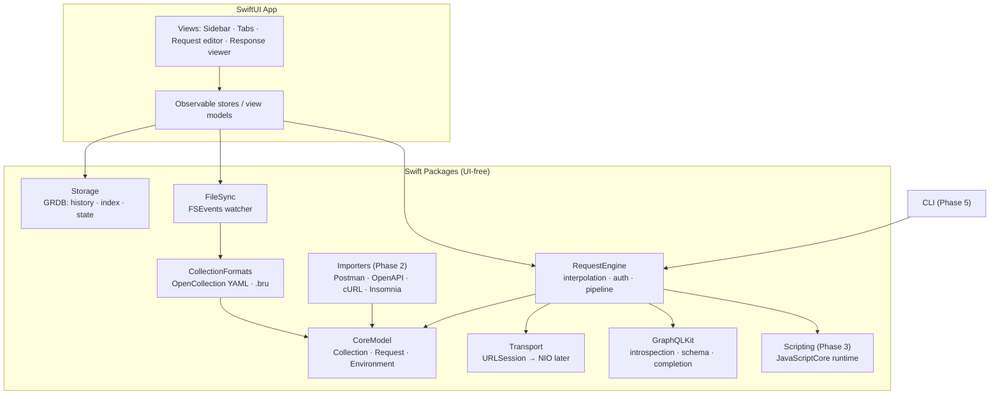
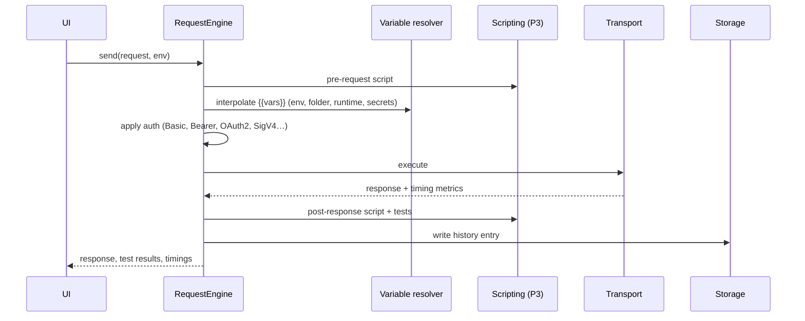

# Courier — Native macOS API Client Plan

## One-page overview

**What:** Courier is an open-source (MIT) API client for macOS, built in SwiftUI and similar to Postman or Bruno. It supports REST and GraphQL first, then grows into a broad tool with scripting, tests, WebSocket/SSE/gRPC, a collection runner and a CLI.

**Decisions so far**

| Area | Decision |
|---|---|
| Name | **Courier**. Suggested bundle ID `com.mrecachinas.courier`, CLI command `courier`. |
| License | Open source under MIT, developed on GitHub |
| Platform | macOS 26 Tahoe and later only, built with Xcode 26 and Swift 6.2 in strict concurrency mode |
| UI | SwiftUI with the Liquid Glass design and Observation framework, plus AppKit where SwiftUI falls short (editors, large tables) |
| Source of truth | Plain-text collection folders. **OpenCollection YAML** (`.yml`, Bruno's default format since v3.1) is the main format, and **`.bru`** files can be read and written too. Each collection is saved in the format it already uses. |
| Saving | Explicit save with ⌘S. Tabs with unsaved changes show a dot, and closing one asks first. No autosave, so Git diffs stay clean. |
| Local database | SQLite through GRDB for history, the search index and UI state. It can always be rebuilt from the files. |
| Secrets | Keychain, plus Bruno-style `.env` files kept out of Git |
| Scripting (later) | JavaScriptCore with a Bruno-compatible `bru` / `req` / `res` API |
| Distribution | Developer ID signing and notarization, Sparkle updates, GitHub Releases and a Homebrew cask. No App Store at first, to avoid the sandbox. |

**Phases**

1. **MVP:** REST and GraphQL requests, Bruno collections, environments, history
2. **Daily use:** full auth support, import/export, cookies, code generation, search
3. **Scripting and tests:** JavaScript pre-request and test scripts, assertions, collection runner
4. **More protocols:** WebSocket, SSE, GraphQL subscriptions, gRPC
5. **Automation:** a CLI that shares the core and produces CI reports
6. **Extras:** mock servers, OpenAPI tools, Git UI, plugins

**Biggest risks:** keeping round-trips exact for both OpenCollection YAML and `.bru`, a native code editor with autocomplete, and GraphQL tooling in Swift. Phase 0 tests each of these with a small spike.

---

## Architecture

The core is a set of pure-Swift packages with no UI code. The SwiftUI app and, later, the CLI both build on these packages.



### Package breakdown

- **CoreModel:** value types for collections, folders, requests (REST/GraphQL/…), environments, auth configs and variables.
- **CollectionFormats:** one `CollectionFormat` protocol with two implementations:
  - **OpenCollection YAML (main format):** checked against the [JSON Schema](https://schema.opencollection.com/). Parsing can use Yams, but Yams drops comments and key order when writing. Writing therefore needs a deterministic emitter that matches Bruno's output (key order, `|-` block scalars) and keeps unknown keys.
  - **`.bru` (legacy):** reads and writes `.bru` files, keeping formatting and unknown blocks.
  - Courier detects the format from the collection root (`opencollection.yml` or `bruno.json`) and writes back in the same format. A "Convert to YAML" command migrates `.bru` collections.
  - Golden tests use files that Bruno itself produced. Saving an unchanged file must produce no diff.
- **RequestEngine:** resolves variables from the global, collection, environment, folder, request and runtime scopes, applies auth, runs scripts (Phase 3), sends the request and records the result.
- **Transport:** a protocol with a `URLSession` implementation first. `URLSessionTaskMetrics` provides DNS, connect, TLS and TTFB timings. A SwiftNIO / AsyncHTTPClient implementation can be added later for raw control (restricted headers, HTTP/1.1 forcing, raw wire view) and is needed for gRPC.
- **GraphQLKit:** runs introspection, caches the schema, powers the schema explorer, and handles validation and autocomplete. Two options:
  - (a) run `graphql-js` and `graphql-language-service` inside JavaScriptCore. This is battle-tested and the fastest route to full parity.
  - (b) write a native Swift GraphQL parser.
  - Recommend (a), behind a Swift protocol so it can be replaced later.
- **Storage (GRDB):** request/response history (large bodies compressed or kept in side files), an FTS5 search index over collections, and UI/tab state. It lives in `~/Library/Application Support/Courier/`.
- **FileSync:** an FSEvents watcher that picks up external edits such as `git pull` or another editor, debounces them, re-parses the changed files and resolves conflicts with unsaved tabs.

### Request lifecycle



### On-disk layout (Bruno-compatible)

OpenCollection YAML, the default for new collections:

```
my-api/
├── opencollection.yml    # collection config: headers, auth, scripts
├── .env                  # secrets (gitignored)
├── environments/
│   ├── local.yml
│   └── prod.yml
└── users/
    ├── folder.yml        # folder-level settings
    ├── get-user.yml
    └── create-user.yml
```

Legacy `.bru` collections use the same layout, with `bruno.json` and `collection.bru` at the root and `.bru` files in place of `.yml`.

Example request (`create-user.yml`):

```yaml
info:
  name: Create User
  type: http
  seq: 1
http:
  method: POST
  url: "{{baseUrl}}/users"
  body:
    type: json
    data: |-
      { "name": "John Doe" }
  auth: inherit
```

---

## UI sketch

- **Window:** `NavigationSplitView` with a collection tree sidebar (Liquid Glass), a custom tab bar of open requests, and the request editor above or beside the response viewer (the split can be toggled). Tabs with unsaved changes show a dot; ⌘S saves the current tab and ⌥⌘S saves all.
- **Toolbar:** environment picker, Send (⌘↩), and the method and URL bar with `{{var}}` highlighting and hover previews.
- **Request tabs:** Params, Headers, Body (JSON, form, multipart, raw, binary/file, GraphQL), Auth, Vars, Script (P3), Tests (P3), Docs.
- **Response viewer:** pretty view with a collapsible JSON tree, raw view, preview (HTML in WKWebView, images), headers, cookies, a timing waterfall, and filtering by JSONPath or jq.
- **GraphQL:** query editor with autocomplete and inline errors, variables pane, schema/docs explorer sidebar, and a re-introspect button.
- **Command palette (⌘K):** jump to any request, switch environments, run actions.
- **Code editor:** test [CodeEditSourceEditor](https://github.com/CodeEditApp/CodeEditSourceEditor) (TreeSitter, native) in a Phase 0 spike. If its autocomplete or performance falls short, fall back to CodeMirror 6 inside a WKWebView for the editor panes only.

---

## Phased roadmap

### Phase 0: Foundations (spikes)
- Xcode project, SPM package layout, CI on GitHub Actions (build, tests, SwiftLint/SwiftFormat).
- Open-source setup: MIT `LICENSE`, README with Mermaid diagrams, `CONTRIBUTING.md`, issue and PR templates.
- **Spike:** OpenCollection YAML and `.bru` parsers and serializers that round-trip files produced by Bruno with no diff.
- **Spike:** editor component with JSON/GraphQL highlighting and autocomplete (a go/no-go decision).
- **Spike:** `graphql-js` running in JavaScriptCore to parse, validate and complete against an introspected schema.
- **Spike:** URLSession transport with timing metrics, cancellation and large/streaming bodies.

### Phase 1: MVP (minimal)
- Open, create and close collections (new ones use OpenCollection YAML; existing `.bru` collections open as they are); sidebar tree; create, rename, move and delete requests and folders.
- REST: method, URL, query params, path params, headers, and body (JSON, raw, form-urlencoded, multipart, file).
- GraphQL: query and variables, introspection, schema explorer, autocomplete and validation.
- Environments with `{{var}}` interpolation; secret values in Keychain or `.env`.
- Basic auth only: none, Basic, Bearer, API key. Collection- and folder-level inheritance.
- Response viewer: pretty, raw, headers, status, size, time.
- History in SQLite with re-open and re-run.
- Tabs, explicit save (⌘S) with unsaved-change dots and a prompt on close, and file watching for external changes.

### Phase 2: Daily use
- Auth: OAuth 2.0 (authorization code + PKCE, client credentials, device flow), Digest, AWS SigV4, NTLM (maybe), client certificates (mTLS).
- Cookie jar per collection; proxy settings; custom CA and option to disable TLS verification.
- Import from Postman v2.1, OpenAPI 3.x, Insomnia and cURL. Export to Postman and cURL. A command converts `.bru` collections to OpenCollection YAML.
- Code generation (cURL, Swift, JS fetch, Python requests, Go) through a template layer.
- Global search (FTS5), command palette, keyboard-first navigation.
- Response tools: JSONPath/jq filter, diff between two history entries, save response as an example.
- Performance work: virtualized large responses (10MB+ JSON).

### Phase 3: Scripting and tests
- JavaScriptCore runtime with Bruno's `bru`, `req` and `res` API, plus `test()` and `expect()` (bundled chai).
- Pre-request and post-response scripts at the collection, folder and request levels.
- Declarative assertions (Bruno `assert` blocks) and runtime variables for chaining requests.
- Collection runner: order, iterations, data files (CSV/JSON), delays, and a results view.
- Sandbox limits: timeouts, memory caps, no file system access except through explicit APIs. Bruno's npm-module support is a known gap.

### Phase 4: More protocols
- WebSocket (`URLSessionWebSocketTask`): connect, send, a message log, saved messages.
- Server-Sent Events: streaming response view.
- GraphQL subscriptions over the `graphql-ws` protocol.
- gRPC through grpc-swift v2: server reflection, `.proto` import, unary and streaming calls. This needs the NIO transport.
- Possible later additions: MQTT, Socket.IO.
- OpenCollection YAML already has request types for WebSocket and gRPC, so these are saved in the standard format. `.bru` collections can't store them; Courier offers to convert the collection first.

### Phase 5: Automation
- `courier` CLI built on the core packages (swift-argument-parser), installed through Homebrew: run collections or folders with an environment, and output JUnit, JSON or HTML reports. It runs on macOS and Linux CI if the core avoids Apple-only APIs. Keep JavaScriptCore and Keychain behind protocols for this reason; Linux needs a separate JS engine for scripts.

### Phase 6: Extras
- Mock server from collection examples or OpenAPI.
- OpenAPI generation from collections, and docs rendering.
- Built-in Git status, diff and commit UI for collections.
- Plugin or extension API; optional AI assistant for generating requests and tests.

---

## Testing strategy
- **CollectionFormats:** golden-file round-trip tests for both formats, using collections produced by Bruno; checks against the OpenCollection JSON Schema; property tests (parse → serialize → parse) and conversion tests (`.bru` → YAML).
- **RequestEngine:** tests against a local test server (Vapor or Hummingbird) covering auth, redirects, multipart, compression, timeouts and TLS.
- **GraphQLKit:** tests against a known schema (e.g. the GitHub or Star Wars SWAPI schemas).
- **UI:** snapshot tests for key views, plus a small XCUITest smoke suite.

## Decisions log
1. **Name:** Courier.
2. **Saving:** explicit ⌘S with unsaved-change dots, no autosave.
3. **License:** open source under MIT.
4. **Platform:** macOS 26 Tahoe and later only (Liquid Glass).
5. **File format:** OpenCollection YAML as the main format, with read/write support for `.bru`. Bruno 3.1 made YAML its default and calls `.bru` legacy.

## Remaining questions
- GitHub repo name and bundle ID. Suggested: `mrecachinas/courier`, `com.mrecachinas.courier`.
- "Courier" is also the name of a notification platform (courier.com). That's fine for a personal open-source app, but check the Homebrew cask name and App Store name before publishing.
